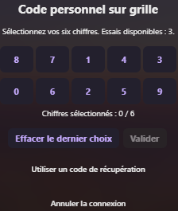

# Code personnel sur grille — twofactor_xygrid 1.2.0
Nextcloud app for two-factor authentication (MFA) based on a 10-digit grid from 0 to 9 generated randomly at each login. The user selects this MFA in his "Settings/Security" and gets a 6-digit code that he will use after entering his username and password. After 3 attempts with the wrong code, it is banned for 1 hour. The Nextcloud administrator can unblock it without changing its 6-digit code. Nextcloud local application, recipe candidate version. Interface and French documentation for the moment in French. No composer dependency or npm to download to build the package.

Installation, OCC commands, security model, troubleshooting, and recipe: docs/ADMINISTRATOR.md.
Enable, Log In, and Retrieve: docs/UTILISATEUR.md.
Administrative Unlock: docs/DEVERROUILLAGE_ADMIN.md.
Test without Nextcloud: php tests/codec.php.
Native provider: xygrid. Application: twofactor_xygrid.
Declared license: GNU Affero General Public License, version 3 or later (SPDX: AGPL-3.0-or-later).

